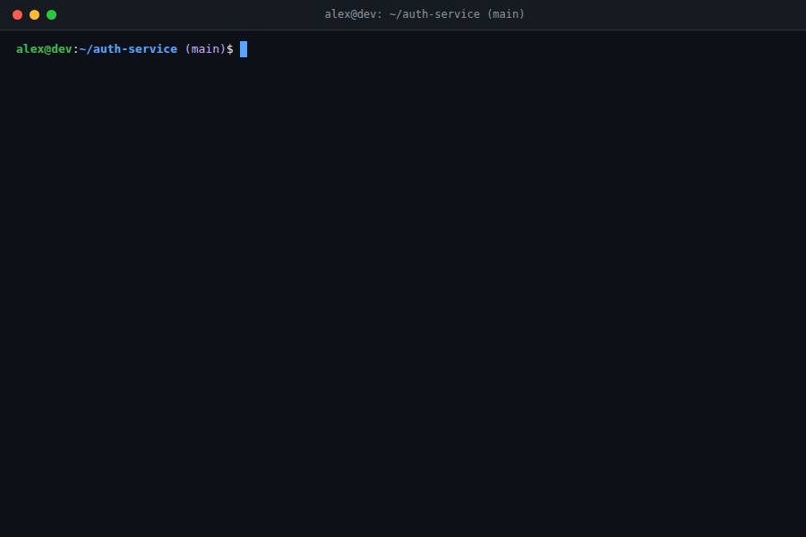

<div align="center">

# ai-commit

零外部依赖、支持任意 OpenAI 兼容接口的 Git Conventional Commits 自动生成钩子。

[](https://github.com/mcocdaa/ai-commit/actions/workflows/ci.yml)
[](https://github.com/mcocdaa/ai-commit/releases/latest)
[](https://www.python.org/downloads/)
[](https://pre-commit.com/)
[](https://conventionalcommits.org/)
[](https://opensource.org/licenses/MIT)

[English](README.md) · [简体中文](README_CN.md)



</div>

## ✨ 核心特性

- **零第三方依赖** — 仅使用 Python 3.9+ 标准库（`json`、`urllib`、`subprocess`、`fnmatch`），无需安装任何额外 `pip` 依赖包。
- **无缝融入 Git 工作流** — 基于 `prepare-commit-msg` 钩子：直接运行 `git commit` 自动生成完整 [Conventional Commits](https://www.conventionalcommits.org/) 提交信息；使用 `git commit -m "摘要"` 时自动在摘要后追加结构化变更详情。
- **智能 Diff 压缩与 `.opencommitignore` 过滤** — 自动剔除各类 Lockfile、压缩产物及 `.opencommitignore` 匹配文件，并对超大 Diff 智能截断以控制 Token 消耗。
- **通用 OpenAI 兼容接口支持** — 开箱即用支持 DeepSeek、OpenAI、Ollama、vLLM 等任意兼容 `/v1/chat/completions` 的服务。
- **多语言生成** — 支持英文（`en`）、简体/繁体中文（`zh`、`zh-TW`）、日文（`ja`）与韩文（`ko`）提交信息。
- **优雅降级** — 绝不阻塞提交流程；若网络超时或 API 调用失败，Git 提交将静默回退并正常继续。

## 🚀 快速开始

### 1. 配置 `pre-commit`

在项目的 `.pre-commit-config.yaml` 中添加 `ai-commit` 并安装 `prepare-commit-msg` 钩子：

```yaml
repos:
  - repo: https://github.com/mcocdaa/ai-commit.git
    rev: v1.0.0  # 可运行 `pre-commit autoupdate` 自动更新至最新版本
    hooks:
      - id: ai-commit
```

```bash
pip install pre-commit
pre-commit install --hook-type prepare-commit-msg
```

### 2. 配置 API Key 并提交

```bash
export AI_COMMIT_API_KEY="sk-..."
git add -A && git commit
```

## ⚙️ 配置说明

支持通过环境变量、项目根目录 `.ai-commit.json` 或全局 `~/.ai-commit.json` 配置（优先级：`环境变量` > `./.ai-commit.json` > `~/.ai-commit.json`）：

| 环境变量 | `.ai-commit.json` 键名 | 默认值 | 说明 |
| :--- | :--- | :--- | :--- |
| `AI_COMMIT_API_KEY` | `api_key` | `""` | OpenAI 兼容接口的 API Key |
| `AI_COMMIT_API_BASE_URL` | `api_base_url` | `https://api.deepseek.com` | Chat Completions 接口基础地址 |
| `AI_COMMIT_MODEL` | `model` | `deepseek-v4-flash` | 用于生成提交信息的模型名称 |
| `AI_COMMIT_LANGUAGE` | `language` | `en` | 输出语言（`en`、`zh`、`zh-TW`、`ja`、`ko`） |
| `AI_COMMIT_MAX_DIFF_LINES` | `max_diff_lines` | `1000` | 单文件 Diff 触发缩写的最大行数阈值 |
| `AI_COMMIT_MAX_OUTPUT_TOKENS` | `max_output_tokens` | `2048` | 模型输出的最大 Token 数 |
| `AI_COMMIT_IGNORE_FILE` | `ignore_file` | `.opencommitignore` | 排除 Diff 分析的忽略规则文件名 |
| `AI_COMMIT_THINKING` | `thinking` | `false` | 是否开启 DeepSeek 模型的思考/推理模式 |
| `AI_COMMIT_DEBUG` | `debug` | `false` | 是否向 `stderr` 输出调试日志 |

<details>
<summary><b>高级配置与常见问题排查</b></summary>

### `.ai-commit.json` 配置示例

```json
{
  "api_base_url": "https://api.deepseek.com",
  "model": "deepseek-v4-flash",
  "max_diff_lines": 1000,
  "language": "zh",
  "ignore_file": ".opencommitignore",
  "thinking": false
}
```

### 自定义忽略规则（`.opencommitignore`）

默认已忽略常见锁文件（`uv.lock`、`package-lock.json`、`pnpm-lock.yaml`、`Cargo.lock`、`poetry.lock`）与 `*.min.js` / `*.min.css`。可在项目根目录创建 `.opencommitignore` 添加自定义规则：

```gitignore
*.md
dist/
fixtures/*.json
```

### 调试模式与钩子阶段配置

- **查看详细调试输出**：设置 `AI_COMMIT_DEBUG=true`，并在 `.pre-commit-config.yaml` 的 `- id: ai-commit` 下添加 `verbose: true` 即可在提交时查看完整流水线日志。
- **避免其他钩子重复执行**：若同时安装了 `pre-commit` 与 `prepare-commit-msg` 钩子，建议在 `.pre-commit-config.yaml` 顶部添加 `default_stages: [pre-commit]`。

</details>

## 📄 License

本项目基于 [MIT License](LICENSE) 开源。
